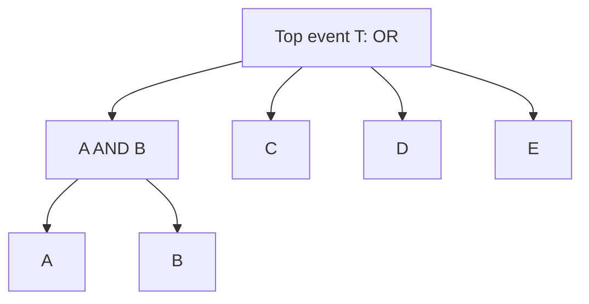

# Fault Tree Analysis (FTA)

[Home](README.md) · [Foundations](foundations.md) · [FMEA](FMEA.md) · [FTA](FTA.md) · [ETA](ETA.md) · [STPA](STPA.md) · [Sources](sources.md)

**Revision:** 13 October 2026 draft. Independent technical review pending. Source-status checks are dated 6 October 2026; see [maintenance and limitations](review-guidance.md#maintenance-and-release).

Fault Tree Analysis (FTA) is a deductive method that starts with a defined undesired top event and examines the combinations of lower-level events or conditions that can produce it. Boolean gates express those logical relationships. The resulting model can support qualitative analysis and, where suitable data and assumptions are available, quantitative analysis. FTA does not start with an already established root cause, and its diagram is not a chronological flowchart. [B09](references.md#b09), [B10](references.md#b10)

## Inputs and outputs

Inputs are a defined top event, system configuration and architecture, operating conditions and relevant causal knowledge. Quantification additionally needs applicable data and a dependence model. Outputs include the fault tree, event register, minimal cut sets, open modeling issues and any conditional numerical result.

## Method steps

### 1. Define the top event and analysis boundary

Define the undesired event or state to be examined, the system configuration, the operating mode and the time or demand basis. Explain its relationship to the safety hazard or loss of concern. A top event can be a system failure, hazardous state or another selected event; it need not be the final accident or the most severe conceivable outcome.

Example: “The braking function fails to provide the specified deceleration after a valid brake demand, during the defined low-speed operating condition.” State the required deceleration, response deadline and exclusions before quantifying this event.

### 2. Identify contributors and construct the logic

Work down from the top event using system functions, failure effects, interfaces and known dependencies. For each parent event, justify whether any one input is sufficient or a combination is necessary. Stop decomposition at an explicit, justified boundary.

Use the [event definitions](#event-symbols) and [gate semantics](#logic-gates-and-advanced-symbols); the tree is not a time sequence.

### 3. Reduce the logic and identify cut sets

First identify combinations of basic events sufficient to produce the top event. A cut set is such a combination; a minimal cut set has no unnecessary member. “Minimal” does not mean that it has the smallest number of events among all cut sets.

Reduce the logic before quantification. If T = A OR (A AND B), then T = A; adding the second branch does not create another independent way for A to happen. If the same physical event appears more than once, use the same identifier and treat it as one event. When different cut sets overlap, summing their probabilities can double-count the overlap. Calculate their union or use a justified approximation with stated limitations.

### 4. Gather applicable data

For each event record its definition, population, reference mission/time/demand, source, uncertainty and dependencies. Do not assign a random-hardware rate to a software design defect or attack without an explicit operational model.

### 5. Quantify only under justified assumptions

| Gate | General probability expression for two inputs | Additional condition |
|---|---|---|
| AND | P(A ∩ B) = P(A)P(B given A) | It reduces to P(A)P(B) only if A and B are independent. |
| OR | P(A ∪ B) = P(A) + P(B) − P(A ∩ B) | Do not omit the overlap without justification. |
| XOR | P(A XOR B) = P(A) + P(B) − 2P(A ∩ B) | Here XOR means exactly one of two input events occurs. |

These expressions concern event probabilities on a common, defined basis. Independence must be justified; it does not follow from drawing events on separate branches. Shared power, environment, maintenance, design or software can create dependence. Preserve the identity of repeated events throughout the tree. [B09](references.md#b09)

**Probability is not failure frequency.** This introductory example calculates the probability of a top event over a specified mission. It does not calculate an occurrence rate or the frequency of entering a failed state. Those quantities require a defined time-dependent model, including repair, restoration and event recurrence where applicable. Do not obtain a frequency by substituting rates into a probability equation or by treating dimensionless probabilities as rates.

For an item initially functioning at time zero, with a constant failure hazard λ and no repair during the mission, the probability of failure by time t is:

Q(t) = 1 − exp(−λt).

λ has units of inverse time and t uses the corresponding time unit. Their product is dimensionless. For sufficiently small λt, Q(t) ≈ λt; the required accuracy determines whether the approximation is suitable. For example, at λt = 0.001 the approximation overestimates Q by approximately 0.05% relative to Q.

This is a lifetime model under stated assumptions. It is not a general expression for repairable-system unavailability and should not be assigned to software design faults without a justified operational model.

### 6. Select measures and evaluate residual issues

Select safety measures based on the modeled causes, the applicable safety objectives and the wider system analysis. Candidate measures include eliminating a hazardous behavior, changing the architecture, preventing a failure mechanism, detecting a condition in time, or providing an effective recovery response. Assess whether each measure introduces new hazards or dependencies, then update the analysis and verify the implemented measure.

A manufacturing defect metric such as defects per million opportunities does not by itself establish that a system safety objective has been met. Any acceptance argument must use criteria appropriate to the defined hazard, operating context and evidence.

Redundancy can reduce the contribution of some failure combinations, but only if the relevant independence, separation, detection and switching assumptions are justified. Consider common power, environmental exposure, shared requirements or software defects and maintenance errors. Additional software instances do not establish independent protection against a shared design defect.

Compare the results with the stated acceptance criteria and document remaining uncertainty, responsible decision-makers and required actions. A color or a small numerical estimate is not itself an acceptance decision.

## Worked Boolean example

The diagram below is newly authored for the existing A–E logic. It is a generic teaching model, separate from the automotive stopping example.

The illustrated logic is T = (A AND B) OR C OR D OR E. Its minimal cut sets are {A,B}, {C}, {D} and {E}. For this numerical demonstration only, assume A–E are mutually independent events defined over the same mission and assign P(A)=0.01, P(B)=0.02, P(C)=0.001, P(D)=0.002 and P(E)=0.003.

Then P(T) = 1 − [1−P(A)P(B)][1−P(C)][1−P(D)][1−P(E)] = 0.0061878081988, or approximately 0.619% per defined mission. These invented values demonstrate calculation, not acceptable vehicle safety performance.

Dependence changes the answer. Keeping P(A)=0.01 and P(B)=0.02, suppose P(B given A)=0.5 instead. Then P(A AND B)=0.005 rather than 0.0002. If the pair {A,B} remains independent of C, D and E, and those three remain mutually independent, P(T)=0.01095906097. Documenting dependence is therefore part of the model, not an optional comment added after calculation.

## Event symbols

**Intermediate event:** an event represented as the output of a gate and potentially as an input to a higher-level gate. Its occurrence contributes according to that higher gate’s logic; it does not necessarily produce the parent event on its own. For example, one input to an AND gate is insufficient unless the other required inputs also occur.

| Term | Description |
|---|---|
| Basic event | An event not developed further within this fault tree. The stopping point reflects the analysis scope and available modeling/data, not necessarily physical indivisibility. |
| Undeveloped event | An event deliberately left without further decomposition; record why it is undeveloped and whether the remaining uncertainty affects the conclusion. |
| Conditioning event | A condition restricting when another modeled event or gate relationship applies. |
| House event | A modeled condition assigned a fixed Boolean state for the analyzed configuration or operating case. |

A top/intermediate event is conventionally shown in a rectangle, a basic event in a circle, an undeveloped event in a diamond, a conditioning event in an oval, and a house event with a house symbol. Define the notation in each analysis; the simplified diagram above uses labeled boxes.

## Logic gates and advanced symbols

| Term | Definition |
|---|---|
| k-out-of-N gate | Output occurs when at least k of the N input events occur, under the stated model. |
| Two-input XOR gate | Output occurs when exactly one of the two input events occurs. |
| Priority AND gate | Output depends on all required input events occurring in the specified order. State whether simultaneous events satisfy the ordering rule and how reset/repair is treated. |
| Transfer symbols | Cross-reference the same identified subtree/event between diagram locations; they do not introduce a separate failure event. |

AND requires all inputs, OR at least one. Two-input probability expressions are given in step 5. Sequence-sensitive gates require temporal semantics and an appropriate solver; ordinary static Boolean calculations do not supply those semantics.

## Extensions and complementary models

| Topic | Relationship to FTA |
|---|---|
| Qualitative and quantitative FTA | Complementary uses of the fault-tree model; quantification is not a separate prerequisite for qualitative insight. |
| Dynamic FTA | An extension for order, sequence or state-dependent behavior; gate semantics and solution method must be specified. |
| Bayesian-network or Markov modeling | Related modeling approaches that may be combined with, derived from or compared with a fault tree. They are not merely new names for an unchanged static FTA. |
| Common-cause/dependent-failure analysis | Supports identification and modeling of dependencies affecting the tree. |
| Software-focused FTA | Application of fault-tree reasoning to specified software/system behavior; numerical treatment needs its own justification. |
| FTA combined with FMEA, ETA or STPA | Integration of different analysis outputs, requiring consistent event definitions and assumptions. |
| Reliability Block Diagrams | A related reliability representation, usually organized around function success; not an FTA variant. |

Use source-specific names for research extensions and explain their added semantics. Hierarchical organization alone is not a distinct analysis method. This list introduces relationships; it does not prescribe an extension for every analysis. [B09](references.md#b09), [B10](references.md#b10)

## Used terminology

| Quantity | Meaning in this page |
|---|---|
| Probability | Dimensionless measure for a specified event and reference conditions. |
| Unreliability Q(t) | Probability of failure by t in the stated lifetime model. |
| Unavailability | Probability that the required function is unavailable at the specified time or demand; restoration can matter. |
| Failure hazard λ(t) | Instantaneous failure rate conditional on survival to time t. |
| Event frequency | Expected number of defined event occurrences per unit exposure, such as operating time. |

## Assessor review and limitations

Use the [assessor checklist and acceptance guidance](review-guidance.md). Record open assumptions, owners and evidence; completing this tutorial does not establish conformity with a standard.

A precise calculation cannot compensate for omitted causes, overlapping events treated as independent, an undefined mission or unsuitable data. See [method reconciliation](automotive-example.md#reconciling-the-methods).

## References and historical context

Method references: NASA’s public Fault Tree Handbook [B09](references.md#b09), IEC 61025:2006 [B10](references.md#b10), and the distinct NEN-EN-IEC 61025:2007 adoption [B15](references.md#b15).

The former traffic-accident percentage figure has been removed from the tutorial. Its historical population, denominator and causal-attribution basis were not established for an ADS probability calculation. See Winkle (2016), [Development and Approval of Automated Vehicles](https://www.researchgate.net/publication/303480787_Development_and_Approval_of_Automated_Vehicles_Considerations_of_Technical_Legal_and_Economic_Risks), for the original discussion; no percentage is adopted here.
