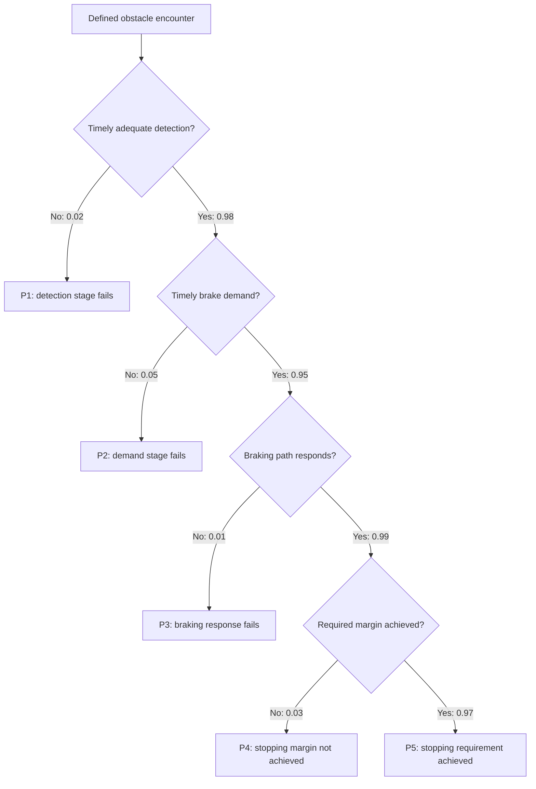
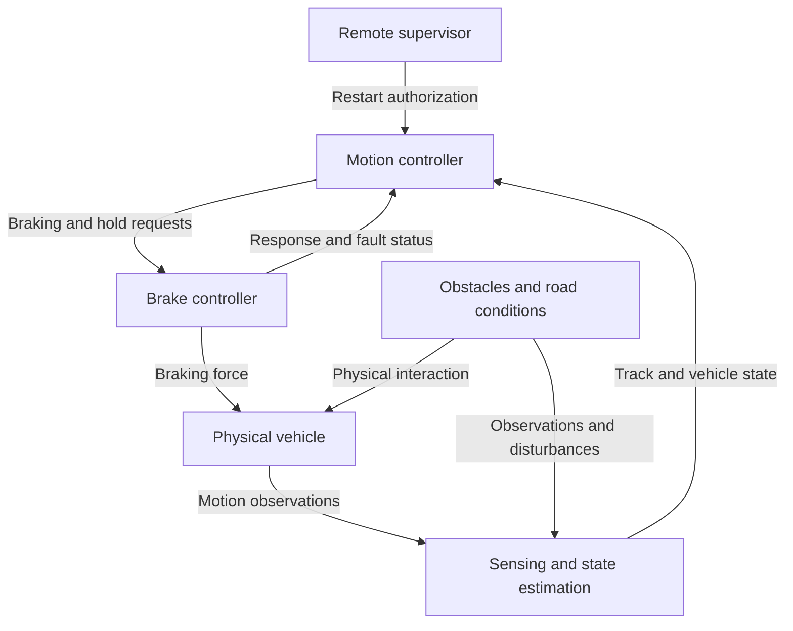

# Shared automotive example: low-speed stopping

[Home](README.md) · [Foundations](foundations.md) · [FMEA](FMEA.md) · [FTA](FTA.md) · [ETA](ETA.md) · [STPA](STPA.md) · [Sources](sources.md)

**Revision:** 13 October 2026 draft. Independent technical review pending. Source-status checks are dated 6 October 2026; see [maintenance and limitations](review-guidance.md#maintenance-and-release).

Original teaching example for this Wiki. No OEM data, completed tests or regulatory conformity is claimed. Read the common scope before using any table.

[Scope and assumptions](#scope-and-assumptions) · [Qualitative function-level FMEA](#qualitative-function-level-fmea) · [Conditional event tree](#conditional-event-tree) · [STPA control analysis](#stpa-control-analysis) · [Reconciling the methods](#reconciling-the-methods)

## Scope and assumptions

The system is a hypothetical driverless vehicle operating on a defined, level, paved route at a maximum speed of 10 km/h. Pedestrians may be present. No human driver or remote supervisor is credited with immediate collision avoidance. This example concerns a stationary relevant obstacle in the vehicle’s intended path, first available to be sensed at a distance of 8 m from the vehicle’s front. It does not cover every pedestrian motion, occlusion, weather condition or maneuver.

The modeled chain consists of obstacle sensing/tracking, a motion controller, a communication path to the brake controller, and brake actuation. A separate independent emergency-braking channel is not assumed. Runtime monitoring and additional protection measures are discussed as proposed actions where indicated; they are not credited as already verified.

| Parameter | Teaching assumption or requirement |
|---|---|
| Maximum initial speed | 10 km/h = approximately 2.78 m/s. |
| Route | Level paved surface; the example’s braking condition supports the required deceleration. |
| Obstacle case | Stationary relevant obstacle in the intended path, available to sensing at 8 m. |
| Allocated total delay | No more than 0.5 s from that encounter condition to onset of effective braking. |
| Braking requirement | At least 2.0 m/s² deceleration until rest for this stopping case. |
| Required final margin | At least 1 m between the vehicle front and obstacle. |
| Restart | Vehicle remains stopped until restart is authorized and the path is confirmed clear. |
| Evidence status | Hypothetical requirements and proposed verification; no actual vehicle tests or measured failure probabilities. |

Under a simplified constant-deceleration calculation, distance traveled before rest is:

`d = v × delay + v²/(2a)`

At the stated maximum speed, 0.5 s delay and 2.0 m/s² deceleration, d is approximately 3.32 m. Adding the 1 m margin gives approximately 4.32 m, below the 8 m encounter distance. This demonstrates consistency of the simplified requirement allocation. It does not validate brake build-up, gradient, tire behavior, sensor errors, moving obstacles or the declared operating domain of a real vehicle.

The 0.5 s allocation is a design requirement with margin; missing it is not automatically proof of a collision. A hazardous late action depends on actual speed, remaining distance and achievable deceleration. Conversely, meeting a local controller deadline is not sufficient if other parts of the stopping chain consume too much time.

## Qualitative function-level FMEA

This example identifies failure modes, effects and candidate actions. It does not assign automotive S/O/D ratings or Action Priority because no justified rating procedure and supporting evidence are supplied. It is complete as an introductory identification and action-planning exercise, not as a release decision.

| ID | Function | Failure mode | Possible cause | Local effect | Vehicle-level concern |
|---|---|---|---|---|---|
| F-01 | Provide a timely obstacle track | Required track is absent or late | Sensing fault, processing delay or communication loss | Controller lacks timely obstacle information | Insufficient stopping margin; possible collision. |
| F-02 | Decide on the required braking response | Brake demand is omitted or issued too late | Incorrect scheduling, decision logic or invalid assumptions about available distance | Brake controller receives no timely demand | Insufficient stopping margin; possible collision. |
| F-03 | Deliver the demanded braking effect | Deceleration is below the requirement | Actuation fault, unavailable energy or inadequate brake capability | Actual slowing is less than required | Vehicle may reach the obstacle before stopping. |
| F-04 | Maintain the stopped state | Vehicle moves before authorized restart | Hold-release logic error or unintended propulsion demand | Rest is not maintained | Vehicle can enter the occupied path. |

| ID | Baseline provision and limitation | Proposed action | Proposed verification and acceptance criterion | Owner role / milestone | Status and residual assessment |
|---|---|---|---|---|---|
| F-01 | Obstacle tracking is assumed; no demonstrated detection/freshness coverage is claimed. | Specify end-to-end information-age handling and a response when required information is unavailable or invalid. | Delay, freeze and remove track messages; demonstrate the specified invalid-data response and preservation of the stopping requirement for the defined encounter. | Perception and control leads / before design release. | Proposed; residual behavior not yet verified. |
| F-02 | A motion controller is assumed; its decision timing is not yet verified. | Allocate the total delay budget to sensing, planning, communication and actuation; verify scheduling and deadline handling. | Exercise worst-case permitted load and relevant delays; show effective braking onset within 0.5 s for the defined encounter, with justified measurement uncertainty. | Control and integration leads / before design release. | Proposed; residual behavior not yet verified. |
| F-03 | A brake function is assumed; no test evidence is supplied. | Establish braking capability and evaluate whether monitoring and a separate response are needed for loss of capability. | Verify at least 2.0 m/s² for the defined condition and test the specified response to identified actuation faults. A detected fault alone is not a pass. | Braking lead / before system validation completion. | Proposed; residual behavior not yet verified. |
| F-04 | Hold-at-rest behavior is required; enforcement is not demonstrated. | Interlock restart with authorization and current path-clear information; examine conflicts with propulsion commands. | Apply premature restart requests, stale clearance and conflicting commands; show no unauthorized movement in the tested cases. | Control lead / before system validation completion. | Proposed; residual behavior not yet verified. |

The effects and candidate measures must be reviewed together. A common loss does not prove identical occurrence or detectability, and a successful diagnostic does not prove that the system can still avoid the hazardous consequence. Record completed evidence and configuration changes before claiming that a proposed action has reduced risk.

For an isolated RPN arithmetic demonstration only, hypothetical ratings S=9, O=2 and D=4 give RPN=72. This multiplication does not establish that those ratings apply to any row above, that 72 is acceptable, or that the corresponding failure is less important than every failure with a higher RPN.

## Conditional event tree

The initiating event is the relevant obstacle encounter defined in [the common scope](automotive-example.md#scope-and-assumptions), not successful obstacle detection. Four successive questions are considered:

1. Is the obstacle detected/classified adequately and in time for the modeled response?
2. Given that information, does the controller issue the required timely brake demand?
3. Given the demand, does the braking path respond?
4. Given that response, does the vehicle achieve the required stopping margin?

Failure at an earlier stage terminates that path in this simplified model. No independent fallback path is credited. The terminal label describes what this model establishes; it does not automatically establish collision or injury.

For calculation practice, assign conditional success probabilities 0.98, 0.95, 0.99 and 0.97 to the four stages. These values are invented and are not evidence of real vehicle performance. In particular, the last stage distinguishes “braking responds” from “the full stopping requirement is achieved”.

| Path | Meaning | Conditional calculation | Result |
|---|---|---|---:|
| P1 | Detection/classification stage fails | 0.02 | 0.0200000 |
| P2 | Detection succeeds; timely demand fails | 0.98 × 0.05 | 0.0490000 |
| P3 | Detection and demand succeed; braking response fails | 0.98 × 0.95 × 0.01 | 0.0093100 |
| P4 | First three stages succeed; stopping margin fails | 0.98 × 0.95 × 0.99 × 0.03 | 0.0276507 |
| P5 | Required stopping margin achieved through the modeled chain | 0.98 × 0.95 × 0.99 × 0.97 | 0.8940393 |
| Total | Partition of the defined model’s paths | Sum of P1–P5 | 1.0000000 |

These products use probabilities conditioned on the preceding successful stages. They do not require an assertion that the stages are independent. The sum checks arithmetic and partition construction; it does not demonstrate that the model includes every real-world behavior. The remaining probability, 0.1059607, describes paths on which this modeled success chain is not completed. It must not be labeled injury probability or field collision rate.

## STPA control analysis

The following is a deliberately limited STPA illustration for the vehicle and encounter defined in [the common scope](#scope-and-assumptions). It does not claim a complete vehicle STPA.

| ID | Loss of concern |
|---|---|
| L-01 | A person is injured or killed in an interaction with the vehicle. |
| L-02 | The vehicle or another object is damaged in a collision. |

| ID | Hazardous system condition | Links |
|---|---|---|
| H-01 | Vehicle speed and remaining distance are incompatible with maintaining the required separation from an obstacle in its path. | L-01, L-02 |
| H-02 | The vehicle moves into a path occupied by a person or obstacle after it has stopped and before safe restart conditions are satisfied. | L-01, L-02 |

| ID | System-level constraint |
|---|---|
| SC-01 | Vehicle motion must preserve the required separation from relevant obstacles, considering available stopping capability and response delay. |
| SC-02 | The stopped vehicle must not resume motion until restart is authorized and the path is confirmed clear. |

The control structure includes a motion controller receiving obstacle-track and vehicle-state information and issuing braking/hold requests to a brake controller. The brake controller acts on the physical vehicle and supplies response/status information. External obstacles and road conditions affect the physical process. A remote supervisor supplies restart authorization but is not credited with time-critical obstacle response.

This is a functional model. The arrows describe actions and information, not a complete network topology or a claim of authenticated communication.

| ID | UCA category | Unsafe control action and context | Hazard |
|---|---|---|---|
| UCA-01 | Not providing | The motion controller does not request braking when an obstacle is in the path and continued motion would consume the available stopping margin. | H-01 |
| UCA-02 | Providing | The motion controller requests an insufficient braking level when the remaining distance requires stronger achievable deceleration to preserve the margin. | H-01 |
| UCA-03 | Too late | The motion controller requests braking only after the remaining distance is insufficient for the achievable response and deceleration. | H-01 |
| UCA-04 | Stopped too soon | The motion controller terminates the braking request before the vehicle has slowed enough to preserve separation from the obstacle. | H-01 |
| UCA-05 | Providing | The motion controller authorizes release of the stopped state while the path remains occupied and vehicle movement would enter that occupied path. | H-02 |

A missed 0.5 s design allocation is evidence of a violated requirement; it is not automatically equivalent to UCA-03. The latter explicitly identifies the hazardous physical context. Likewise, some prolonged hold conditions might cause an operational delay without causing either of the losses selected here; they should not be invented as safety UCAs merely to fill a table cell.

| ID | Derived controller constraint |
|---|---|
| CC-01 | Request adequate braking before continued motion consumes the available stopping margin. |
| CC-02 | Select a braking demand sufficient for the required separation under the defined braking capability and conditions. |
| CC-03 | Maintain the necessary braking request until adequate stopping/separation is achieved. |
| CC-04 | Do not authorize release into an occupied path; require valid restart authorization and current path-clear information. |

**Causal scenario LS-01.** An interface retains an old path-clear value and does not expose its age to the motion controller. A new obstacle becomes available to sensing at 8 m, but updated information is delayed. The controller continues to regard the path as clear and requests braking only after 2.2 s. At 10 km/h, the vehicle has already traveled about 6.11 m. Even with immediate subsequent deceleration at 2.0 m/s², its additional stopping distance is about 1.93 m. The modeled vehicle cannot maintain the required separation. This explains one route to UCA-01/UCA-03 and H-01; it is not just a list containing “message delay”.

**Causal scenario LS-02.** The motion controller issues a correct timely brake request, but a communication or brake-controller defect prevents it from being applied to the vehicle. H-01 can then occur without an unsafe request from the motion controller. The analysis must therefore examine the control path and physical response as well as the controller’s decision logic.

| Traceability element | Worked entry |
|---|---|
| Loss | L-01: injury to a person. |
| Hazard | H-01: speed/distance incompatible with required separation. |
| UCA | UCA-01/UCA-03: absent or physically too-late brake request in the stated context. |
| Constraint | CC-01 and SC-01. |
| Scenario | LS-01: stale clear-path information and delayed update. |
| Proposed design measure | Specify end-to-end information-age validity, behavior on expired/missing data, and the total response-time allocation. |
| Proposed verification | Freeze, delay, reorder and suppress information; verify validity handling and actual stopping behavior. For the defined encounter, demonstrate effective braking within 0.5 s and at least the required final margin under the specified conditions. |
| Evidence status | Test plan proposal only; no passed test result or residual-risk acceptance is claimed. |

## Reconciling the methods

The methods examine different aspects of the same example. FMEA identifies function failures and effects. STPA examines when control is unsafe and how information, control and physical behavior can produce it, including correctly functioning components with unsuitable assumptions. ETA follows developments after the defined encounter. FTA can analyze combinations contributing to a selected event identified by the other analyses.

For example, the ETA’s failure of the braking-response stage can be developed with an FTA whose top event is “The required braking response is not delivered after a valid demand”. Candidate branches include an unavailable communication path, a brake-controller failure and insufficient actuation capability. A real tree must establish precise definitions, relevant combinations and dependencies; listing these candidates alone is not a completed FTA. The separately worked A–E tree illustrates Boolean reduction and quantification without pretending that its independent probabilities describe this vehicle.

Do not infer identical numerical probabilities from similar-looking labels across the methods. The input event, operating mode, time basis, conditional assumptions and physical meaning must match before results can be transferred. Shared identifiers and a reconciliation table make that comparison reviewable.

| Concern | FMEA | STPA | ETA/FTA connection |
|---|---|---|---|
| Missing/late obstacle information | F-01 | LS-01 and UCA-01/UCA-03 | Detection stage or another explicitly defined information-delay event. |
| Wrong or late brake decision | F-02 | UCA-01/UCA-02/UCA-03 | Demand stage; causes can be investigated further. |
| Demand not realized physically | F-03 | LS-02 | Braking-response stage; candidate FTA top event. |
| Unsafe movement after stopping | F-04 | H-02/UCA-05/CC-04 | Outside the stopping ETA; requires a separate restart scenario. |

The last row illustrates a coverage boundary: the stopping ETA does not automatically cover restart merely because another method identifies it.

[Download the matching qualitative FMEA workbook](example_files/fmea-qualitative.xlsx). The workbook includes a blank template and these worked rows, with no invented numerical ratings.
